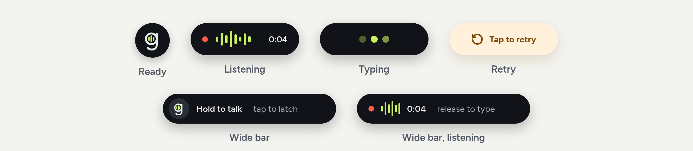

<p align="center"></p>

# gillspeak for Android (experimental)

Dictation for Android: hold the mic, talk, let go, and clean text lands in the focused field. Two ways in:

<p align="center"></p>

- **Floating bubble** (recommended): keep your usual keyboard; a small round **g** appears over it whenever you type. Hold it to talk, or tap to start and tap again to finish. While recording it stretches into a night pill with a red dot, lime sound bars that follow your voice, and a timer. Drag it anywhere, including onto the keyboard; size and shape (round bubble or a wide bar) are set in the app. It uses an accessibility service to see when a keyboard and a text field are on screen and to type into that field; it skips password fields.
- **gillspeak keyboard**: a full-screen mic keyboard, for when you'd rather switch keyboards.

- **Voice commands** from the side button: hold it, say what you want, and gillspeak does it. See [Voice commands](#voice-commands).

- **Mindful mode**: a time limit on YouTube Shorts, Instagram Reels and TikTok, shared between them (10 minutes by default, from 30 seconds to 30 minutes). At the limit a full-screen card covers the feed: "Leave" goes home and pauses the feeds for 30 minutes; "5 more minutes" is offered once, after a 10-second wait. A 5-minute break resets the time. It is a separate accessibility service, **gillspeak focus**, that only sees those three apps and only reads which screen is open, never what is on it. Turn it on from the app's **Mindful mode** page.

- **Nothing leaves your phone.** There are no cloud options. Choose the speech model in **Speech and understanding**: Parakeet TDT 0.6B v3 (the default, ~640 MB, English and 24 other European languages) or [Cactus Whistle](https://huggingface.co/Cactus-Compute/whistle) (16.9 MB, English, German, French, Spanish, Italian, Dutch and Polish). Each runs on the phone, followed by the same clean-up rules. Downloads use Android's DownloadManager (Wi-Fi only, resumable), and each file is SHA256-checked. You can keep both downloaded and switch with **Use Parakeet** or **Use Whistle**; the selection applies to the keyboard, bubble and voice commands. The models' downloads are the only time the app uses the network.
- **Optional polish with Gemma 4 E2B** on the phone: the desktop's clean-up prompt, gate and validator, ported to Kotlin. If a polished text fails validation, the rules-cleaned transcript is inserted instead.
- Keyboard: ⌨ goes back to your previous keyboard, ↶ removes the last dictation, and a failed request keeps the audio: tap the status line to retry.
- The app's home screen shows what still needs setting up, then one row per section with its current value: speech and understanding, bubble, snooze, words and keys, and recent dictations (the last 30, kept only on the phone). Light and dark; on a foldable's inner screen the list and the open section sit side by side.

Tested on a Galaxy S25 (Android 17, One UI 9) and a Galaxy Z Fold5 (Android 16). Needs Android 11+.

### Headset microphones

The bubble, keyboard and side button share the same input selection: a connected wired headset microphone,
then a USB microphone, then a Bluetooth communication headset. Among Bluetooth routes, the current communication
device wins; otherwise LE Audio is preferred over classic HFP/SCO. Android 12+ uses the communication-device API,
including LE headsets Android exposes as compatible; Android 11 uses SCO. Playback-only headphones (including
A2DP or a USB adapter without an input) do not provide a microphone.

Wait for the input label before speaking. Bluetooth setup runs in the background for up to five seconds. The
label comes from the active recording input, rather than assuming the requested headset was selected. The keyboard
and side-button screen show it; the floating bubble announces it in a toast. If setup fails, GillSpeak releases the
headset route, tries the phone microphone, and explains the fallback. If no input can be confirmed, recording fails
instead of claiming a headset is in use. A microphone change/disconnect during capture stops and discards that
session; tap again to start with the available input. An incoming call or another communication app can prevent
Bluetooth setup. Cancelling, closing the activation surface, and service shutdown release capture and routing.

No pairing, Bluetooth scan, Nearby devices permission, network service or phone call is needed. The additional
`MODIFY_AUDIO_SETTINGS` permission is Android's normal permission for the temporary communication route. Speech
still uses the on-phone Parakeet/Gemma pipeline and the 16 kHz mono WAV format in memory.
Classic SCO devices that reject 16 kHz capture are retried at 8 kHz and converted in memory for ASR.

Hardware verification is still required for Android 11 SCO, current Android HFP, compatible BLE, wired TRRS and
USB headsets. For each, check the reported input and a short dictation from all three activation surfaces, then
cancel, disconnect, deny/revoke microphone access, and stop the service. Confirm ordinary media/call routing works
afterwards. Unit tests use fake audio endpoints and never activate a real microphone.

## Install

Download **[gillspeak-0.2.0.apk](https://github.com/hkgill/gillspeak/releases/download/android-v0.2.0/gillspeak-0.2.0.apk)** (experimental; Android 11+, arm64) on your phone, open it and allow installing from your browser or file manager. No account or API key is needed. See the [Android release notes](https://github.com/hkgill/gillspeak/releases/tag/android-v0.2.0) for the checksum. GitHub's **Latest** release currently points to the older Linux package; Android releases are prereleases.

The published 0.2.0 APK is local-only by default and still offers optional Gemini/Groq modes that send audio if enabled. The feature descriptions above follow the current source on `main`, which has removed those cloud options.

Then set it up as described at the end of [Build and install](#build-and-install).

## Voice commands

Make gillspeak the phone's digital assistant (in the app, the **Side button** step in *Setup*, or *Settings → Apps → Choose default apps → Digital assistant app*). Holding the side button then opens a see-through gillspeak screen instead of Gemini: the screen dims, a lime wave runs out of the side button round the edge, and the bubble drops in and listens. It stops when you stop talking (or tap the pill), shows a card saying what it understood, and does it.

| Say | What happens |
| --- | --- |
| "Open Spotify", "launch the camera" | Opens the app whose name is closest (a slight mishearing still matches) |
| "Set a timer for 10 minutes", "half an hour timer" | Starts a timer in the Clock app |
| "Set an alarm for 6:30 am", "wake me up at seven" | Sets an alarm in the Clock app |
| "Turn on the torch", "flashlight off" | The torch |
| "Pause", "resume", "next song", "previous track" | Whatever is playing |
| "Text Sam I'm running late" | Opens Messages to Sam with the text filled in; you tap Send |
| "Call Mum" | Opens the dialler with Mum's number; you tap Call |
| "Navigate to the airport" | Directions in Maps |
| "Add dentist tomorrow at 3 to my calendar", "schedule a meeting with Sam on Friday at 2:30" | Opens your calendar's new-event screen filled in; you tap Save |
| "Search for …", or anything else | Offers a web search, only if you tap it |

- **Only these commands ever run.** The transcript is matched by rules in `Commands.kt` on the phone; a model never decides what to do. Texts and calls are never sent or dialled by gillspeak.
- **Texting and calling by name** need the contacts permission; contacts are read on the phone when you ask and never stored.
- Giving gillspeak the assistant role turns off "Hey Google" and Gemini's overlay; the Gemini app still opens from its icon.
- **Dictating instead.** In the app, *Speech and understanding → Holding the side button → Dictates* makes the side button a hands-free bubble: the same screen listens, stops when you stop talking, and types what you said into the text field you were in. The bubble's accessibility service does the typing, so it needs to be on; without it the text is copied for you to paste.
- The words appear after you stop talking with either speech model.
- The wave starts 40% of the way down the right edge, where the side button is on Galaxy S-series phones.

## Build and install

Needs the Android SDK (platform 36), NDK 29.0.14206865, CMake 3.22.1 and a JDK 17–21. The Android Gradle plugin can install the native build tools when SDK licenses are accepted. Android Studio's bundled JBR works; JDK 25 is too new for the Android Gradle plugin.

```bash
cd android
echo "sdk.dir=$HOME/Android/Sdk" > local.properties
JAVA_HOME=/path/to/jdk21 ./gradlew testDebugUnitTest assembleDebug
adb install -r app/build/outputs/apk/debug/app-debug.apk
```

`local.properties` is git-ignored.

Wireless debugging (Android 11+): Developer options → Wireless debugging → Pair device with pairing code, then `adb pair IP:PAIRPORT CODE` and `adb connect IP:PORT` (the port on the main Wireless debugging screen).

Then open the app and allow the microphone. For the bubble, turn on **gillspeak bubble** under Settings → Accessibility → Installed apps (apps installed from a file rather than adb may first need *App info → ⋮ → Allow restricted settings*). For the keyboard, turn on **gillspeak keyboard** in keyboard settings and switch to it. On Samsung phones, *Settings → General management → Keyboard list and default → Keyboard button on navigation bar* makes switching quicker.

### Release a signed APK

Release builds are signed with a keystore that never goes in the repo. Create it once and back it up: without it you can't publish an update that installs over an earlier release.

```bash
keytool -genkeypair -v -keystore ~/.android/gillspeak-release.jks -alias gillspeak \
  -keyalg RSA -keysize 4096 -validity 10000
```

Add the signing settings to `local.properties`:

```properties
release.storeFile=/home/YOU/.android/gillspeak-release.jks
release.storePassword=...
release.keyAlias=gillspeak
release.keyPassword=...
```

Raise `versionCode` and `versionName` in `app/build.gradle.kts`, then build and attach the APK to a GitHub release (never commit it):

```bash
JAVA_HOME=/path/to/jdk21 ./gradlew testDebugUnitTest assembleRelease
cp app/build/outputs/apk/release/app-release.apk /tmp/gillspeak-0.2.0.apk
gh release create android-v0.2.0 /tmp/gillspeak-0.2.0.apk --prerelease --title "Android 0.2.0 (experimental)"
```

Without the `release.*` settings, `assembleRelease` produces an unsigned `app-release-unsigned.apk` that Android won't install.

## Develop

- `app/src/main/assets/clean_v2.txt` is a copy of `gillspeak/prompts/clean_v2.txt`; `PromptSyncTest` fails if they drift. Gemma's polish uses it.
- `RulesTest` holds cases copied from `tests/test_rules.py` and `tests/test_validate.py`. Android's regex engine is ICU, not the JVM's: don't use `(?U)` (ICU rejects it at load time, which JVM tests won't catch).
- `MicController` is the mic state machine (hold, latch, retry) shared by the keyboard and the bubble. The bubble waits 150 ms before starting the mic so a drag never starts a recording, and refuses to send all-silent audio (what Android returns when it blocks background recording).
- Logs: `adb logcat -s gillspeak` shows why the bubble is or isn't shown, how long Parakeet and Gemma took, and how text was inserted.
- Debug builds have test hooks, reachable from adb only (a debug-only receiver that requires `DUMP`):

  ```bash
  adb push clip.wav /data/local/tmp/t.wav
  adb shell run-as dev.hkgill.gillspeak sh -c 'mkdir -p files && cp /data/local/tmp/t.wav files/t.wav'
  adb shell am broadcast -n dev.hkgill.gillspeak/.DebugReceiver --es selftest t.wav
  adb shell am broadcast -n dev.hkgill.gillspeak/.DebugReceiver --ez download_model true
  adb logcat -s gillspeak
  ```

### Whistle runtime

The ARM64 C API is linked through a small JNI bridge. Gradle fetches its static library and header from an immutable Hugging Face revision and checks SHA256; the app downloads only the model weights. The native API runs locally without the Python telemetry wrapper, and telemetry opt-out variables are set before loading it. Apache 2.0 license text is bundled in the app's assets.

Whistle's runtime has no unload API, so its model mapping and recognition state remain until the app process exits, including after switching models. Parakeet still releases its recognizer after five idle minutes. Model file size is not a measurement of runtime memory or recognition accuracy.

## Watch

`watch/` (Wear OS app) and `watchface/` (Watch Face Format, no code) are the agent watch face; `agent-status/` is their shared plain-Kotlin logic, tested with `./gradlew :agent-status:test`. They don't touch the phone app. See [docs/agent-watch-face.md](../docs/agent-watch-face.md).

`whistle-probe/` is a Wear OS test app that checks whether a watch can run Whistle itself and how fast; it reuses the phone app's JNI bridge. See [docs/whistle-on-watch.md](../docs/whistle-on-watch.md).
