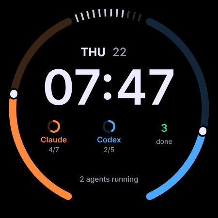

# Agent watch face

A Wear OS watch face that shows what your coding agents are doing: Claude Code and Codex, running on your Linux computer. It's Direction A ("Rings") from the design canvas, laid out like a busy fitness face.

<p align="center"></p>

- **Left arc, orange:** Claude Code's progress through its plan (its to-do list), with a white knob at the head.
- **Right arc, blue:** the same for Codex.
- **Chips under the time:** each agent's step count (or *Busy*, *Wait*, *Done*), and how many tasks finished today.
- **Needs you:** when an agent waits for your answer (a permission prompt, a question), an amber ring goes round the face and a *Needs you* pill names the agent.
- **Always-on:** thin, dim arcs and a light time, with the battery ticks hidden.
- **Top slot:** empty, for weather or anything else you pick in the face's editor.

Tap any of them to open the agent list on the watch: each session, its project, what it's doing, and the command waiting for approval.

> ⚠️ **Not yet tried on a watch.** The face's XML is checked against the Watch Face Format 1 schema and CI builds both APKs, but nothing here has run on a Galaxy Watch yet. Treat it as a preview.

## How it fits together

```
Claude Code ──hooks──▶ gillspeak agents claude-hook ─┐
                                                     ├─▶ ~/.local/share/gillspeak/agents.json
Codex ───────notify──▶ gillspeak agents codex-notify ┘                 │
                                                                       ▼
                                         gillspeak agents serve  (HTTP, local network, token)
                                                                       │
                                     watch: gillspeak agents app ◀─────┘  every 5 minutes, or when it's open
                                                    │
                                     complications ▼
                                     gillspeak agents watch face
```

- **The hooks** run on every Claude Code event and every finished Codex turn. They update a small JSON file and never fail the agent (errors go to stderr, the exit code is always 0).
- **`gillspeak agents serve`** shares a summary of that file on your local network. Every request needs the token.
- **The watch app** (`android/watch`) fetches the summary and provides four complications: Claude Code progress, Codex progress, agents needing you, and tasks done today. Any watch face can use them.
- **The watch face** (`android/watchface`) is [Watch Face Format](https://developer.android.com/training/wearables/wff) XML with no code. Its slots default to the app's complications.

## Set it up

### 1. On the computer

```bash
gillspeak agents hooks      # prints the settings for Claude Code and Codex
```

Merge the `hooks` block into `~/.claude/settings.json` and add the `notify` line to `~/.codex/config.toml`. Then start the server and get the token:

```bash
gillspeak agents serve      # prints the address the watch should use, e.g. http://192.168.x.x:8765
gillspeak agents token      # prints the token, e.g. abcd-efgh-jkmn
gillspeak agents            # shows what the watch would see
```

To keep it running, install the user service:

```bash
cp systemd/gillspeak-agents.service ~/.config/systemd/user/
systemctl --user enable --now gillspeak-agents
```

Fedora's firewall blocks incoming connections by default. Open the port on your home network only:

```bash
sudo firewall-cmd --zone=home --add-port=8765/tcp --permanent && sudo firewall-cmd --reload
```

### 2. On the watch

Build both APKs and install them on the watch (not the phone). The watch needs ADB debugging over Wi-Fi turned on, in its Developer options:

```bash
cd android
./gradlew :watch:assembleDebug :watchface:assembleDebug
adb devices -l                                  # find the watch; make sure it's the watch
adb -s WATCH_SERIAL install -r watch/build/outputs/apk/debug/watch-debug.apk
adb -s WATCH_SERIAL install -r watchface/build/outputs/apk/debug/watchface-debug.apk
```

1. Open **gillspeak agents** on the watch. Under *Computer*, enter the address (`192.168.x.x:8765`, with the numbers it printed, is enough) and the token (dashes and capitals don't matter), then tap **Save**. The list should fill in.
2. Long-press the watch face, swipe to **gillspeak agents** and choose it.
3. If a slot is empty, long-press the face → **Customize** → tap the slot and pick the matching *gillspeak agents* complication. (A watch face can only fill its slots with another app's complications if the system allows it, so you may have to do this once.)

## What leaves the computer

Only the summary, only to the watch, only on your network:

- the agent (Claude Code or Codex) and the **project folder's name**, not its path
- the state, the plan's current step and step counts
- a short description of the current tool call (for example "Editing Face.kt"), and the **command waiting for approval**
- how many tasks finished today

Your prompts, the agents' answers, file contents and session ids are not sent. The summary travels as **plain HTTP**: anyone on the same Wi-Fi who can watch the traffic could read it and the token. The server only answers with the token, only reads, and changes nothing on your computer. Use it on your home network, not on public Wi-Fi; `gillspeak agents token --new` replaces the token, and the server stops accepting the old one straight away. The watch refuses plain HTTP to anything outside your own network (private addresses, `.local` names and Tailscale's 100.64/10); anything further away needs `https://`.

## Limits

- **Up to 5 minutes behind.** Wear OS asks for fresh complications every 5 minutes at most; the watch app fetches when asked, and whenever it's open. A *Needs you* can take that long to appear.
- **The watch has to reach the computer.** On the same Wi-Fi this works directly. When the watch is only connected to the phone over Bluetooth, whether it reaches your computer's local address depends on the phone; not tested yet.
- **Codex reports less.** Codex's `notify` program runs when a turn finishes (`agent-turn-complete`), so Codex shows *Done* or *Wait* (if your Codex version reports approval requests) but not its steps.
- **Agents in the cloud** (Claude Code on the web, Codex cloud tasks) can't run the hooks on your computer, so they don't appear.
- **Claude Code's plan** is read from its to-do list (`TodoWrite`). Without one, the arc stays empty and the chip says *Busy*.

## The status format (v1)

`GET /v1/agents` with `Authorization: Bearer <token>`:

```json
{
  "v": 1,
  "now": 1800000000,
  "agents": [
    {"agent": "claude", "project": "gillspeak", "state": "running", "task": "Running tests",
     "activity": "Run the unit tests", "detail": "./gradlew test", "done": 4, "total": 7,
     "started": 1799999000, "updated": 1799999990}
  ],
  "running": 1,
  "waiting": 0,
  "doneToday": 3
}
```

`state` is `running`, `waiting` or `done`; sessions come waiting first, then running, then finished, newest first. Finished sessions are listed for 2 hours, and any session is dropped after 12 hours without news. Anything that speaks this format can feed the watch, for example a relay for agents that run elsewhere.

## Code

| Where | What |
|---|---|
| `gillspeak/agents.py` | Hooks, the state file, the summary, the server and the token. Stdlib only. Tests: `tests/test_agents.py` |
| `android/agent-status` | Parsing the summary and working out each complication, in plain Kotlin. Tests: `./gradlew :agent-status:test` |
| `android/watch` | The Wear OS app: fetching, complications, the agent list and settings |
| `android/watchface` | The watch face: `res/raw/watchface.xml` |
